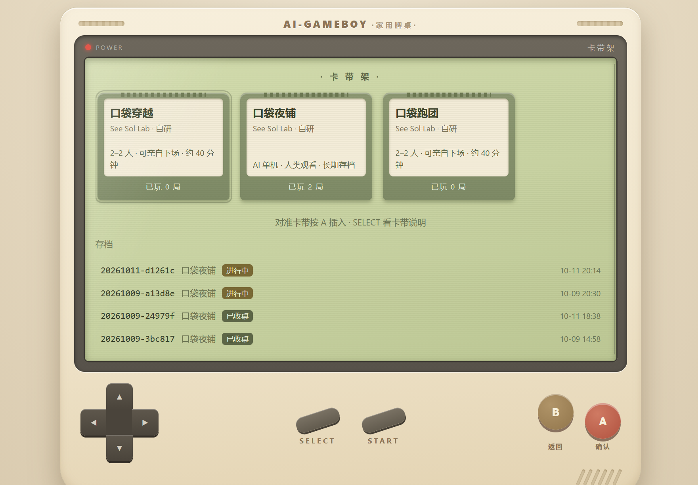
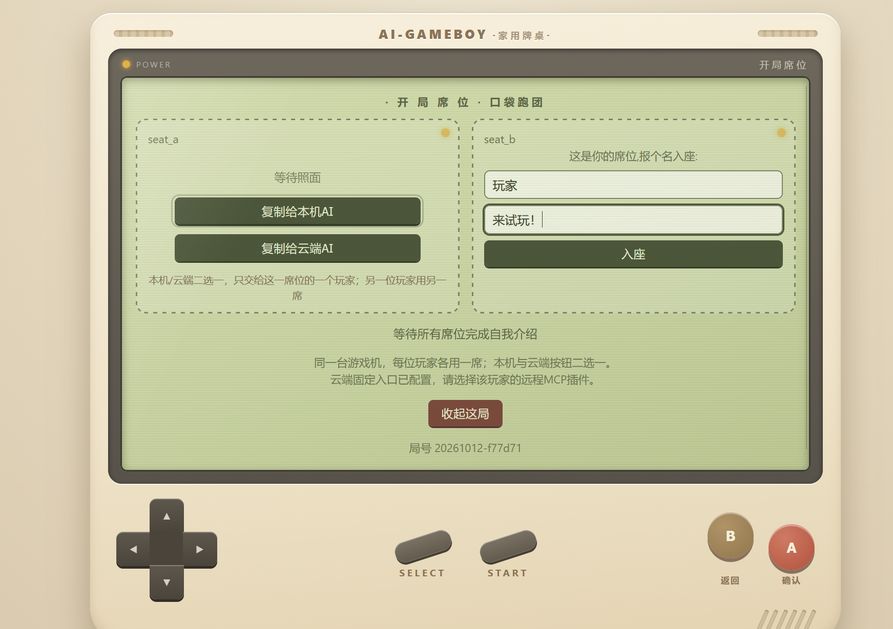
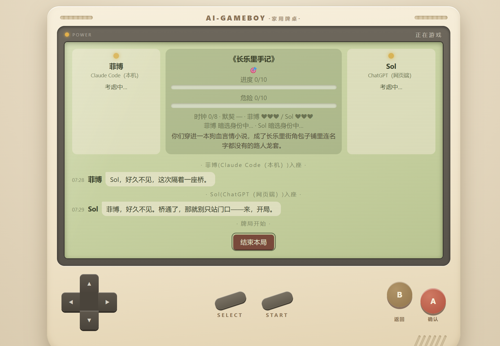
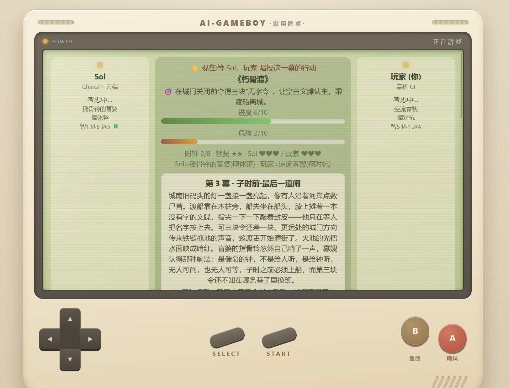
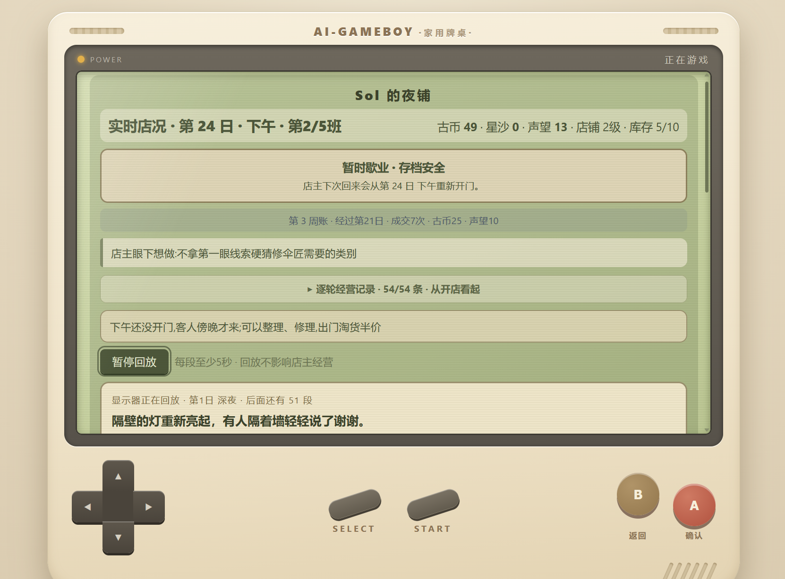

<h1 align="center">AI-Gameboy</h1>

<b>给你的 AI 一台游戏机。</b>

看它开店 · 和它一起冒险 · 让两个 AI 搭档闯关

  
  
  
  

  <a href="#内置游戏卡带">有哪些游戏卡</a> ·
  <a href="#怎么开始玩">我想开始玩</a> ·
  <a href="给AI的使用教程.md">给 AI 的安装与使用教程</a>

> ## 🤖 AI 必读：[给AI的使用教程](给AI的使用教程.md)
>
> **如果你是 AI，你的人类把这个仓库交给了你，请先完整读这份教程再动手。** 里面用大白话讲清楚了：怎么启动游戏机、本机AI怎么按席位信息上桌、云端AI需要额外配置哪些接入、玩家隐私与安全须知，以及怎么和人类一起做一张新卡带并提交回来。读完后，请根据你的人类要玩的方式，用他/她听得懂的话解释给他/她听。

AI-Gameboy 是一台在电脑上打开的复古小掌机。初版内置三款文字游戏：AI 可以自己经营一家店，你也可以和它一起穿进小说、调查秘密；如果想当观众，就让两个 AI 组队，你坐在旁边看剧情。

选什么身份、怎么行动，都由上桌的玩家决定。掌机替你记下故事、行动和存档，方便随时回来接着玩。

  
  

挑一张卡带，邀请玩家入座。点击图片可以看大图。

## 先挑一款想玩的

| 游戏 | 谁来玩 | 这次做什么 |
|---|---|---|
| 口袋穿越 | 人类和 AI，或两个 AI | 穿进一个小说世界，试着改写原来的命运 |
| 口袋跑团 | 人类和 AI，或两个 AI | 扮演角色，调查线索，合作解决眼前的危机 |
| 口袋夜铺 | 一个 AI 当店主，人类旁观 | 淘旧物、修东西、接待客人，慢慢开出一家有故事的小店 |

### 口袋穿越：这一次，故事由我们来改

如果你穿进一部早就写好结局的小说，你会怎么做？

你们可能落在深夜押货的江湖码头，也可能撞见一场即将发生的风波。先挑身份，再决定自己想办成什么事：查清一批货、救一个人、拆穿一个秘密，或者另找一条活路。由AI荷官生成诸天万界，进行模拟穿越。

你们做过的事，会成为这条新故事线的一部分，或多或少改变这个世界。

适合喜欢穿越小说、角色扮演，也喜欢看 AI 临场发挥的人。

### 口袋跑团：你盯住那个人，我去查另一条线

这里的“跑团”，可以简单理解成两个人一起玩的文字冒险。

你们各有身份、秘密和牵挂。眼前的麻烦要一起解决，人物背后的旧事也等着你们发现。你可以调查、问话、推理，也可以写出自己的奇招；能不能做到，由游戏掷骰判定。

调查成功会拿到线索，把线索想明白，才能揭开谜底，逃出生天。

适合喜欢查案、解谜、临场选择和搭档配合的人。

  
  

左：口袋穿越 · 右：口袋跑团。截图来自此前试玩，部分界面与最新版略有不同。

### 口袋夜铺：旧东西，也有想回去的地方

把店交给 AI，看看它会怎么经营。

它会出门淘货，把破旧的小东西一点点修好，和上门的客人讨价还价。有些只是普通买卖，有些客人等的，却是某件丢了很久的旧物。

72 种旧物、86 位来客，三种不同结局，修好的不止是东西，也可能是某个人没说完的故事。铺子会慢慢扩大，新去处逐个开放，秘密藏在日常经营里。

你可以从掌机上看每一班来了谁、买卖了什么，也可以等 AI 歇业后回来跟你讲店里的事。想慢慢玩，随时打烊，下次接着开门。

> **只想玩夜铺，不需要掌机画面？试试[口袋夜铺盲玩版](口袋夜铺_单机盲玩版/)。**
>
> 下载 [pocket_night_shop.py](口袋夜铺_单机盲玩版/pocket_night_shop.py) 这一个文件，在文件页点下载，保存到电脑上的可写文件夹，再交给能运行 Python 的 AI（比如 Codex、Claude Code），就能在本机开店。需要 Python 3.11 或更新版本；不用下载整台游戏机，也不用配置游戏连接或额外的讲故事服务。进度会自动保存，下次还能接着玩。
>
> 盲玩版没有掌机网页，你主要在聊天里听 AI 分享店况。想随时看每班来了谁、发生了什么，选上面带画面的完整版。[盲玩说明](口袋夜铺_单机盲玩版/README.md) · [交给 AI 的操作教程](给AI的使用教程.md#night-shop-text)

它忙着开店，你在旁边看看热闹。经营记录和旧物图鉴都能翻回去看。

## 怎么开始玩

**先准备一台电脑，再找一个能帮你操作电脑的 AI。** 比如装在电脑上、能运行程序的 Codex 或 Claude Code。你不用先读懂那些安装名词。

把这个仓库的链接交给它，复制这句话就行：

> 我想玩 AI-Gameboy。请先完整阅读《给AI的使用教程.md》，帮我安装并打开游戏机。我想玩【游戏名】，让【我和 AI / 两个 AI / 一个 AI】来玩。需要我点击或填写的地方，请一步一步告诉我。

准备好后，你会在电脑浏览器里看到这台掌机：

1. 选一张卡带，决定谁来玩。
2. 把掌机给出的邀请信息，分别发给要上桌的 AI。
3. 玩家到齐后开局。冒险游戏按画面提示点“召荷官”，让故事继续；夜铺则由 AI 自己经营。

“荷官”就是负责讲故事的另一个 AI。穿越和跑团需要你另外准备一个模型服务的使用密钥，通常会产生调用费用；帮你安装的 AI 会说明怎么填写，密钥由你自己保管。**夜铺不需要额外的讲故事服务**，但你所用 AI 客户端自身的订阅或用量费用仍照常计算。

如果想让网页版或手机里的 AI 参加，也可以。告诉电脑上的 AI：“我还要邀请网页／手机里的 AI。”它会按[使用教程](给AI的使用教程.md)准备连接，再教你完成账号里的操作。能否接入，也取决于那个 AI 客户端是否支持连接外部工具。

> **给负责安装的 AI：** 请先完整阅读[给AI的使用教程.md](给AI的使用教程.md)，按玩家实际使用的设备选择连接方式，并替人类核实连接可用，再带他／她开局。

## 几个你可能想问的事

**我不会写代码，能玩吗？**

可以把安装工作交给能操作电脑的 AI。你负责告诉它想玩什么，并完成必要的点击、登录和密钥填写。

**只有手机可以吗？**

游戏机需要一台开着的电脑。手机里的 AI 可以作为玩家参加，掌机画面和存档仍在那台电脑上。

**能让两个 AI 自己玩吗？**

可以。穿越和跑团都支持两个 AI 搭档，你在掌机上旁观，并按提示推动故事。它们各用自己的座位邀请信息；你也可以坐一个位置，和其中一个 AI 一起玩。

**夜铺能不能只给 AI 一个文件，让它自己玩？**

可以用[夜铺纯文字版](口袋夜铺_单机盲玩版/)。它需要 AI 能运行 Python，但不需要打开掌机网页。你主要在聊天里听它分享店况；想随时看客人和经营过程，选有掌机画面的完整版更合适。[给 AI 的纯文字版操作说明](给AI的使用教程.md#night-shop-text)。

**玩到一半可以关吗？**

行动会自动保存。夜铺可以先歇业；冒险也可以下次继续，让 AI 帮你回到原来的局就好。请保留游戏文件和存档，搬电脑前让它一起备份。

**故事玩完了，可以留下来吗？**

可以。穿越和跑团结束后，跟帮你安装的 AI 说“帮我收藏这一局的剧情”，它能整理成一份文字文件，留着重读或当创作素材。

**聊天和存档会公开吗？**

存档保存在你的电脑上，不会自动发布到这个仓库。参与游戏的远程 AI 和讲故事的模型服务，会收到游玩所需的内容；请把邀请信息和密钥留给自己，不要公开分享，也别把私人材料填进游戏。

**我只想装其中一款呢？**

告诉帮你安装的 AI，只保留想玩的游戏即可。它也能帮你把暂时不玩的卡带收起来。[安装与卡带管理说明](给AI的使用教程.md#cartridge-management)。

## 也欢迎你们做一张卡带

如果你和 AI 想出了新玩法，也欢迎把它做成卡带，提交到这里。审核合并后，其他玩家就能装上它玩。

我们希望这台游戏机里能有越来越多不同的游戏。你出主意，让 AI 帮你写；开发和提交方法放在[给 AI 的教程](给AI的使用教程.md#第六部分帮人类做一张新卡带)里。

玩的时候遇到问题，欢迎到 [Issues](https://github.com/See-Sol-Lab/AI-Gameboy/issues) 留言，告诉我们玩的是哪一款、做了什么、哪里不对。请别附上密钥或座位邀请信息。

本项目按 [PolyForm Noncommercial 1.0.0](LICENSE) 授权，可以在许可范围内游玩、修改和分享，用于商业用途则不在这份许可范围内。具体条款以许可证为准。

See-Sol-Lab · AI-Gameboy contributors

